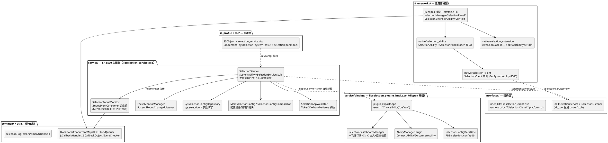

# 架构设计及约束

## 架构设计

### 设计原则

| 原则 | 描述 | 理由 |
|---|---|---|
| SA 按需生命周期 | SA 8500 不随开机常驻：`sa_profile/8500.json` 定义 start-on-demand（参数 `sys.selection.switch=on`、事件 `usual.event.USER_SWITCHED`）与 stop-on-demand（`switch=off`），`BootStartPhase` 加载、`auto-restart:true`；主动退出调 `UnloadSystemAbility(8500)`（`service/src/selection_service.cpp:1074-1088`） | 划词是低频场景，闲置即卸载省内存 |
| 依赖就绪后再初始化 | 对 MMI(3101)/WMS(4606)/CES(3299) 的初始化全部挂在 samgr `SubscribeSystemAbility` 就绪回调后（`InitSystemAbilityChangeHandlers`，selection_service.cpp:872）；启动早期只 `WatchParameter("bootevent.boot.completed")` | 避免 SA 间启动顺序假设 |
| 插件解耦重依赖 | pasteboard、RDB、ability_runtime 三个重依赖收进 `service/plugins/`（`libselection_plugins_impl.z.so`），主服务 dlopen 9 个 `extern "C"` 函数指针调用；主服务 BUILD.gn 禁止直连 `ability_runtime:ability_manager` | 主服务可裁剪、依赖边界显式；CFI 配置可按 DSO 独立对齐（plugins 需与 `native_rdb` 一致） |
| 配置双轨同步 | 配置同时存于系统参数（`sys.selection.*`）与 RDB（用户级），`SelectionConfigComparator::DoCompare` 单点裁决同步方向（`service/src/selection_config_comparator.cpp:93-143`），内存镜像 `MemSelectionConfig` 统一供读 | 支持用户级绑定 + 快速读 + 跨用户切换一致性 |
| 事件驱动状态机 | 划词识别不解析文本，只消费 MMI 键鼠事件流驱动 `SelectInputState` 状态机；文本获取延后到应用请求 `GetSelectionContent` 时经虚拟键盘注入 + 剪贴板订阅完成 | 识别与取词解耦：识别纯事件态，取词纯文本态 |
| 回调三段式分发 | JS 回调统一 `EventHandler::PostTask(..., VIP)` → `JsCallbackHandler::Traverse`（NAPI）/ 直接向量遍历（ANI）；面板操作经 `FFRTBlockQueue`（10s 超时）串行化（`common/ffrt_block_queue.h`） | 回调不阻塞 IPC/事件线程，面板操作有序 |
| 编译期统一加固 | 全部产物 `sanitize{cfi, cfi_cross_dso, ubsan, integer_overflow, boundary_sanitize}` + `branch_protector_ret="pac_ret"` + `-fvisibility=hidden` + `--exclude-libs,ALL`（`service/BUILD.gn` 等） | 干净构建即静态检查门（无独立 lint） |

### 逻辑架构

各层职责与关键源码：

| 层/模块 | 职责 | 核心文件 |
|---|---|---|
| SA 主服务 | 生命周期、IPC 入口、按需装卸插件、配置同步 | `service/src/selection_service.cpp`、`service/include/selection_service.h` |
| 输入监测状态机 | 双击/三击/滑动识别、Ctrl 触发、取词时序 flag | `service/src/selection_input_monitor.cpp`、`service/include/selection_input_monitor.h` |
| 焦点监听 | WMS 焦点变化 → 面板 Dispose | `service/focus_monitor/` |
| 配置 | 参数仓库、内存镜像、比较器、RDB 插件 | `service/src/sys_selection_config_repository.cpp`、`selection_config_comparator.cpp`、`service/plugins/src/database/` |
| 插件 so | pasteboard/ability/rdb 解耦实现、统一导出面 | `service/plugins/`（导出面 `service/plugins/src/plugin_exports.cpp`） |
| IDL 契约 | IPC 协议定义与生成 | `interfaces/idl/ISelectionService.idl`、`ISelectionListener.idl` |
| inner-api | 面向系统应用的 C++ 客户端 | `interfaces/inner_kits/selection_client/`（+ `frameworks/native/selection_client` 共源） |
| 应用框架 | Panel 窗口、扩展基类、监听器实现 | `frameworks/native/selection_ability/`、`selection_extension/` |
| JS/ETS 接口 | NAPI 四模块 + Taihe ANI 胶水 | `frameworks/js/napi/`、`frameworks/ets/` |
| 公共设施 | 并发原语、回调分发、事件名白名单、日志/错误码 | `common/`、`utils/` |

启动顺序（`OnStart` → `Init`，selection_service.cpp）：
`OnStart`: fdsan 置 FATAL → `WatchParameter("bootevent.boot.completed")`（失败立即 Init）→ `Publish(GetInstance())` → `StartHisyseventTimer()`（12h 统计定时器）。
`Init`（boot 完成回调）: `SelectionConfigComparator::Init()` → `SynchronizeSelectionConfig()`（参数+DB 比较同步，`shouldStop` 则 `DisableSAService()+UnloadService()`）→ `RegisterSystemAbilityStatusChangeListener()` → `WatchParams()`。
SA 就绪回调链：MMI(3101)→`InputMonitorInit()`（AddMonitor）；WMS(4606)→`InitFocusChangedMonitor()`；CES(3299)→`SubscribeSysEventReceiver()`（锁屏/切用户/装卸应用）。
`OnStop` → `Shutdown()`（逐项反注册）→ `UnloadPluginSo()`。

### 非功能设计

| 场景类别 | 方案设计 |
|---|---|
| 可靠性 | SA `auto-restart:true`；扩展连接 promise/future + 5 秒超时（超时上报 `CONNECT_EXTENSION_TIMEOUT`/`DISCONNECT_EXTENSION_TIMEOUT`）；取词窗口期 `selectionEventId_` 原子比对防竞态（`INVALID_TIMING`）；插件 5 分钟闲置自动卸载（面板显示或扩展连接时保留，`PLUGIN_UNLOAD_TIMEOUT_MS=300000`，dlclose 前 `CLEANUP_DELAY_TIME=50ms`） |
| 性能 | 识别纯事件态零文本处理；取词链路 `std::async` 注入 + `cv_.wait_for(110ms)`（`MAX_DELAY_WAIT_FOR_PB`）；JS 回调 VIP 队列；`getSelectionContent` 频控 500ms 窗口 50 次（`EXCEPTION_TOO_FREQUENT 33600004`）；面板 Show 等 UI 就绪 `3×100ms` |
| 并发 | 服务端不建专属线程（回调来自 binder/MMI/CommonEvent COMMON/Timer/async 线程）；状态机 `atomic` 状态位 + `shared_mutex selectionInfoMutex_`；插件句柄 `shared_mutex pluginMutex_`；剪贴板管理器 `mutex+condition_variable` + `weak_ptr` 防 use-after-free；事件一致性靠 `selectionEventId_`/`selSeqId` |
| 安全 | IPC 三入口（Register/Unregister/GetSelectionContent）强制 `SelectionAppValidator`（CallingTokenID→HapTokenInfo→bundleName 与 `sys.selection.app` 前缀比对，`service/src/selection_app_validator.cpp`）；进程 8 权限 + ACL `INPUT_MONITORING`；参数 DAC 0775；RDB `SecurityLevel::S1`；符号面收敛（versionscript/map/visibility） |
| 可观测 | hisysevent `SELECTION_PROCESS_ABNORMAL`（FAULT：`SelectFailedReason` 0..4）+ 12 小时 `SELECTION_STATISTIC` 计数；hiappevent `api_diagnostic`（createPanel 时延/结果）；hitrace `SelectionMethodSyncTrace`（扩展连接等 TraceTaskId） |
| 兼容 | IDL 改动只改 `.idl` 重新生成；inner-api `platformsdk` + versionscript 锁定；Taihe 胶水部分生成（`frameworks/ets/taihe/*/src`） |
| 约束形态 | PC/2in1 + 外接键鼠；内容上限 6000 字节（订阅长度 2000 字符×3 字节体现，`selection_content_validator.cpp` 的 `CONTENT_MAX_BYTES=6000` 为未接入 BUILD.gn 的预留实现）；支持扩展屏 |

## 架构约束

- **主服务不得直连 ability_runtime**
  - **what**：`service/BUILD.gn` 明确禁止 `ability_runtime:ability_manager` 依赖；ConnectAbility 一律经 `service/plugins/`（`AbilityManagerPlugin`）。
  - **why**：保持 SA 裁剪性与依赖边界；插件 so 可单独跟随重依赖编译配置（CFI 对齐）。
- **生成代码不可手改**
  - **what**：`interfaces/idl/*.idl` 生成的 `*_proxy.cpp/*_stub.cpp`（`${target_gen_dir}`）与 `frameworks/ets/taihe/*/src` 的 Taihe 胶水。
  - **why**：改动在下次生成时丢失且无法审计；改 `.idl` 重建即可。
- **导出面即 ABI**
  - **what**：`libselection_client.z.so` 只导出 `*SelectionClient*`（`interfaces/inner_kits/selection_client/selection_client.versionscript`）；SA so 用 `service/selection_service.map` 显式白名单；插件 so 仅 `plugin_exports.cpp` 的 `extern "C"` 符号 `visibility("default")`。
  - **why**：新增符号不进清单会被静默隐藏或意外导出；公共 inner-api 变更需兼容性评审（platformsdk）。
- **按需行为三件套联动**
  - **what**：`sa_profile/8500.json`、`etc/init/selection_service.cfg`、`etc/para/selection.para(.dac)` 一起变更（开关默认值、事件拉起、uid/secon/DAC 耦合）。
  - **why**：任何一处单独改动会造成真实设备上 SA 加载时机/权限不一致。
- **sceneboard 双分支**
  - **what**：window_manager 依赖按全局开关 `window_manager_use_sceneboard` 分支为 `libwm_lite`+`SCENE_BOARD_ENABLE` 或 `libwm`；运行时代码用宏守卫（如 `MoveWindowToGlobalDisplay` 仅 sceneboard）。
  - **why**：两形态窗口接口行为不同，漏分支在另一形态上崩溃。
- **CFI 跨 DSO 一致性**
  - **what**：`service/plugins/BUILD.gn` 的 CFI 配置必须与 `relational_store:native_rdb` 保持一致，并带 `-Wl,-z,now`。
  - **why**：不一致会在跨 DSO 调用处 CFI 校验失败（加载期或调用期崩溃）。
- **新增依赖必须在 bundle.json 声明**
  - **what**：任何 `external_deps` 新条目须已存在于 `bundle.json` 的 `component.deps.components`（34 项）。
  - **why**：跨部件依赖是部件边界变更，否则构建直接失败。
