# 业务背景

## 应用定位

### 核心职责
selectionfwk 部件（`bundle.json` 部件名 `selectionfwk`，子系统 `systemabilitymgr`，`@ohos/selectionfwk`）是 OpenHarmony 的**划词服务子系统**：全局捕获用户在任意应用中选中的文本，并驱动划词扩展应用弹出智能面板，实现"选中文本 → 弹出面板"的翻译/摘要/扩写等扩展体验。syscap 为 `SystemCapability.SelectionInput.Selection`。

- 划词内容管理：订阅剪贴板一次性观察者获取选中文本，校验纯文本、非空并过滤全套 Unicode 空白字符后交给划词应用（`service/plugins/src/pasteboard/selection_pasteboard_manager.cpp`）；
- 划词事件处理：经多模输入监听键鼠事件，用状态机识别单击滑动/双击/三击选词（`service/src/selection_input_monitor.cpp`）；
- 划词配置管理：管理服务开关、触发方式（ctrl/立即）、划词应用与用户绑定，系统参数 + RDB 双轨持久化（`service/src/sys_selection_config_repository.cpp`、`service/plugins/src/database/`）；
- 面板管理：为划词扩展应用提供 `WINDOW_TYPE_SELECTION` 浮动窗口面板的创建/显示/移动/隐藏/销毁能力（`frameworks/native/selection_ability/src/selection_panel.cpp`）；
- 对外接口：JS/ETS 四模块（`selectionManager`/`SelectionPanel`/`SelectionExtensionAbility`/`SelectionExtensionContext`，NAPI + Taihe FFI）、native inner-api `libselection_client.z.so`（platformsdk 标签）。

运行形态为 SystemAbility **8500**（进程 `selection_service`，lib `libselection_service.z.so`），由 samgr 按需拉起。

### 职责边界（本组件不负责）
- **不做文本处理业务**：翻译/摘要等智能逻辑归划词扩展应用（如 `com.selection.selectionapplication`）；本服务只负责捕获、分发与面板基础设施。
- **不提供跨设备能力**：不支持跨设备划词（README 约束）。
- **不管理普通窗口**：面板窗口是扩展应用进程内的 `WINDOW_TYPE_SELECTION` 浮窗；通用窗口管理归窗口管理子系统（WMS/Rosen），本仓只调用其接口。
- **不直接依赖 ability_runtime**：SA 主服务经 `service/plugins/` 插件间接调用 `AbilityManagerClient::ConnectAbility`（`service/BUILD.gn` 明确禁止主服务直连 `ability_runtime:ability_manager`）。
- **不做输入法**：无 IMSA 依赖（`frameworks/native/selection_ability/include/selection_attribute.h` 的 `InputAttribute` 结构未接入主链路）。
- **不覆盖不可复制应用**：应用禁止复制时取词失败（`CANNOT_GET_CONTENT`，剪贴板 `PB_ERR_CANNOT_GET_CONTENT=7` 映射），黑白名单仅预留（`appBlocklist` 为空实现）。
- **d.ts 不在本仓**：`@ohos.selectionInput.*` 的 API 声明位于大仓 `interface/sdk-js/api/`；本仓提供 NAPI/ANI 实现。

## 系统上下文

```plantuml
@startuml
skinparam componentStyle rectangle
actor "用户（键鼠操作）" as user
package "外部子系统" {
  component "多模输入 MMI (SA 3101)" as mmi
  component "窗口管理 WMS/Rosen (SA 4606)" as wms
  component "剪贴板 pasteboard" as pasteboard
  component "samgr / safwk" as samgr
  component "公共事件服务 (SA 3299)" as ces
  component "AAKit ability_runtime" as aakit
  component "os_account / init 参数" as osacc
  component "hiappevent / hisysevent" as dfx
}
package "selectionfwk" {
  component "selection_service (SA 8500)\nSelectionService + SelectionInputMonitor\n状态机 + 焦点监听 + 配置同步" as sa
  component "service/plugins\nlibselection_plugins_impl.z.so\n(pasteboard/ability/database 解耦)" as plugins
  component "frameworks/native\nselection_ability(Panel)/selection_client/\nselection_extension" as native
  component "frameworks/js/napi + ets/taihe\nselectionManager/SelectionPanel/\nSelectionExtensionAbility/Context" as jsapi
}
actor "划词扩展应用\n(如 com.selection.selectionapplication)" as extapp

user --> mmi : 双击/三击/滑动+Ctrl
mmi --> sa : InputManager::AddMonitor\n(IInputEventConsumer)
wms --> sa : RegisterFocusChangedListener\nListWindowInfo/GetFocusWindowInfo
sa <--> samgr : 按需加载(8500)/Publish\nUnloadSystemAbility
ces --> sa : SCREEN_LOCKED/USER_SWITCHED\nPACKAGE_ADDED
osacc --> sa : 前台账号 id\nsys.selection.* 参数
sa --> plugins : dlopen + 9 个 extern "C" 函数
plugins --> pasteboard : SubscribeDisposableObserver\n(PLAIN_TEXT, 2000*3)
plugins --> aakit : ConnectAbility(Want)
extapp --> jsapi : on('selectionCompleted')\ngetSelectionContent/createPanel/show...
jsapi --> native : NAPI/ANI 胶水
native --> sa : libselection_client\n(ISelectionService IPC: RegisterListener/\nUnregisterListener/GetSelectionContent)
sa --> native : ISelectionListener IPC\n(OnSelectionChange/FocusChange)
native --> wms : Rosen::Window::Create\n(WINDOW_TYPE_SELECTION 浮窗)
sa --> dfx : SELECTION_PROCESS_ABNORMAL\nSELECTION_STATISTIC
jsapi --> dfx : api_diagnostic 打点
@enduml
```

关键外部接口：
- IPC：`ISelectionService`（RegisterListener/UnregisterListener/GetSelectionContent，`interfaces/idl/ISelectionService.idl`）、`ISelectionListener`（OnSelectionChange/FocusChange，`interfaces/idl/ISelectionListener.idl`），proxy/stub 由 idl_tool 生成到 `${target_gen_dir}`；
- 系统参数：`sys.selection.switch/trigger/app/uid`（默认 `on`/`ctrl`/`com.selection.selectionapplication/SelectionExtensionAbility`/`-1`，`etc/para/selection.para`，DAC `sysselection:sysselection:0775`）；
- 进程身份：uid/gid `sysselection`，APL `system_basic`，SELinux `u:r:selection_service:s0`（`etc/init/selection_service.cfg`）。

## 核心输入

| 输入 | 来源 | 主要内容 | 触发时机 |
|---|---|---|---|
| 键鼠事件 | MMI（`InputManager::AddMonitor`，SA 3101 就绪回调后注册） | KeyEvent（Ctrl 键）、PointerEvent（左键按下/抬起/移动） | 用户单击滑动/双击/三击/Ctrl |
| 焦点变化 | WMS（`RegisterFocusChangedListener`，SA 4606）与 MMI（BUTTON_DOWN 时 `GetFocusWindowInfo`） | `SelectionFocusChangeInfo`（windowId/displayId/pid/uid/isFocused/source） | 面板外窗口获焦 |
| 剪贴板文本 | pasteboard 一次性订阅 `SubscribeDisposableObserver(PLAIN_TEXT, 2000*3)` | 选中文本（≤2000 字符）+ 错误码 | Ctrl+C 注入后回调 `OnTextReceived` |
| 系统参数变化 | init 参数 watcher（`WatchParameter`） | `sys.selection.switch/trigger/app` 变更 | 设置应用/用户切换 |
| 公共事件 | CommonEvent（COMMON 线程模式） | SCREEN_LOCKED/UNLOCKED、USER_SWITCHED、PACKAGE_ADDED/CHANGED | 锁屏/切用户/装卸应用 |
| IPC 请求 | 划词应用经 `libselection_client` | RegisterListener/UnregisterListener/GetSelectionContent | 模块加载/取词 |
| SA 就绪事件 | samgr `SubscribeSystemAbility` | MMI(3101)/WMS(4606)/CES(3299) 就绪回调 | 延迟初始化 |
| 前台用户 | os_account `GetForegroundOsAccountLocalId` | userId（重试 50×100ms） | 配置同步 |

## 核心输出

| 输出 | 接收方 | 业务作用 |
|---|---|---|
| `OnSelectionChange(SelectionInfoData)` IPC 回调 | 已注册的划词扩展应用 | 通知划词完成，携带选区类型/坐标/displayId/windowId/bundleName |
| `FocusChange(SelectionFocusChangeInfo)` IPC 回调 | 划词扩展应用 | 通知面板外获焦（触发面板隐藏/销毁 Dispose） |
| `GetSelectionContent` 应答（String） | 划词扩展应用 | 校验过滤后的选中文本（错误码 `SelectionServiceError` 1..7） |
| 面板窗口（`WINDOW_TYPE_SELECTION` 浮窗） | 扩展应用进程内 UI | Menu/Main 两类面板呈现翻译/摘要等内容 |
| 扩展应用连接（`ConnectAbility`） | 划词扩展应用 | 建立服务↔应用通道（5 秒超时） |
| 系统参数写入（`sys.selection.*`） | init 参数服务 | 配置同步落参（含 `switch=off` 自卸载） |
| RDB 记录 | `/data/service/el1/public/selection_service/selection_config.db` | 用户级配置持久化（表 `selection_config`，S1） |
| hisysevent（domain `SELECTIONFWK`） | HiView | `SELECTION_PROCESS_ABNORMAL`（FAULT：注入失败/文本接收失败/面板创建失败/连接超时）、`SELECTION_STATISTIC`（12 小时周期计数） |
| hiappevent | HiAppEvent | `api_diagnostic`/`api_exec_end`（SDK_OCG，createPanel API 时延与结果） |
| 虚拟键盘事件 | `/dev/uinput`（"Selection VKeyboard"） | Ctrl+C 注入触发系统复制 |
